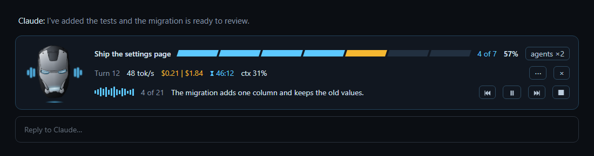

# Mark-2 HUD

A heads-up display above the [Claude Code](https://claude.com/claude-code) prompt. It reads Claude's replies aloud in a local neural voice, shows the plan as it progresses, and keeps turn, cost, prompt cache and context in view.



*Mockup of the HUD using the mod's real helmet drawing. The numbers and text are examples.*

> Free, unofficial fan project. Not affiliated with or endorsed by Marvel or Anthropic. See [Licence](#licence).

## What you get

The helmet sits beside three rows. Its mouth moves with the voice.

| Row | What it shows |
|---|---|
| **Mission** | The plan's steps as armour plates, the percentage done, and a button for the agents panel when subagents ran. |
| **Telemetry** | Turn number, output speed, turn and session cost, prompt cache countdown (red under ten minutes), and how full the context is. |
| **Voice** | What is being read and where (sentence 4 of 21), with Back, Pause, Next and Stop. |

`⋯` opens a tray for speed, voice, full reply or summary, auto-read and code blocks. `×` folds the HUD down to the helmet and its play button.

## Install

You need [uv](https://docs.astral.sh/uv/getting-started/installation/), which sets up the voice engine the first time it is used. Then, at the prompt of a terminal session:

```
/plugin install mark-2-hud --marketplace SimsonCorreya/mark-2-hud
```

Answer `y` to add the marketplace, then pick a scope. From a shell:

```bash
claude plugin install mark-2-hud --marketplace SimsonCorreya/mark-2-hud
```

In the desktop app: click **+** next to the prompt box, then **Plugins**, **Add marketplace** with `SimsonCorreya/mark-2-hud`, then **Add plugin**.

### Add a voice

The voice needs at least one Piper model. Run `/mark-2-hud voices` to see the folder, then download a voice's `.onnx` and `.onnx.json` files from [rhasspy/piper-voices](https://huggingface.co/rhasspy/piper-voices) into it. On Windows the folder is `%LOCALAPPDATA%\claude-read-aloud\voices`; on macOS and Linux it is `~/.local/share/claude-read-aloud/voices`.

## Commands

`/mark-2-hud` reads the last reply aloud. Also:

| Command | What it does |
|---|---|
| `pause`, `resume`, `stop`, `next`, `back` | Control the reading |
| `faster`, `slower`, `speed 1.5` | Change the speed |
| `summary`, `full` | Read a short summary or the whole reply |
| `auto on` / `off` | Read each new reply automatically |
| `code on` / `off` | Read or skip code blocks |
| `voices` | List voices and how to add more |
| `say`, `say word = how to say it`, `say word =` | List, add or remove pronunciations |
| `learn on` / `off` | Let Haiku suggest how to say new unusual words |
| `agents`, `limits`, `stats on` / `off` | Show or hide panels and the stats row |
| `alerts on` / `off` | Notify before the prompt cache expires |
| `warm on` / `off` | Keep the prompt cache warm while you are away |
| `shield on` / `off` / `now` / `at 85` | Pause a task before the session limit and continue after it resets |
| `show`, `hide` | Show or hide the whole HUD |
| `demo 8` | Preview the cache warning |

## What it does on your computer

No analytics, and no servers of its own.

**Stays on your computer:** speech is made locally by Piper. Settings and pronunciations are stored only on your machine. The text being read is held in a temporary folder and deleted when the reading ends.

**Sent to Claude, using your usage allowance:**

| Feature | What is sent | Default |
|---|---|---|
| Learn new words | Unusual words with their sentence, to Haiku | On (`learn off`) |
| Summary mode | The reply, to Haiku | Off (`summary`) |
| Keep warm | A short ping to your session when the cache is about to expire | Off (`warm on`) |
| Shield | A pause message, pings while waiting, then "continue" | Off (`shield on`) |

**Downloaded:** the first time the voice is used, `uv` installs Piper and its Python dependencies.

**Added to Claude:** two tools, `mcp__mark-2-hud__progress` and `mcp__mark-2-hud__step`, so Claude can report its plan. A short note in the system prompt asks it to do so. Turn this off with the `planReports` setting, and the Mission row will follow only task lists and subagents.

Everything is in this repository, so you can read exactly what runs: `hooks/` is the HUD and `scripts/speaker.py` is the voice.

## macOS notifications (optional)

On a Mac, cache warnings can be native notifications that open the session when clicked. Build the helper once (needs Xcode's command line tools):

```bash
bash notifier/build.sh
```

Without it, or on Windows and Linux, Mark-2 HUD uses Claude Code's own notification.

## Licence

The code is [MIT licensed](LICENSE), copyright Simson Correya. It includes MIT-licensed code by johnnyvizz from [claude-kit](https://github.com/johnnyvizz/claude-kit), with thanks: see [`LICENSE-session-band-savvy-progress`](LICENSE-session-band-savvy-progress).

The helmet is fan art based on the Iron Man character, which belongs to Marvel, and the MIT License grants no rights in it. Details, along with the Piper licence, are in [THIRD_PARTY_NOTICES.md](THIRD_PARTY_NOTICES.md).
